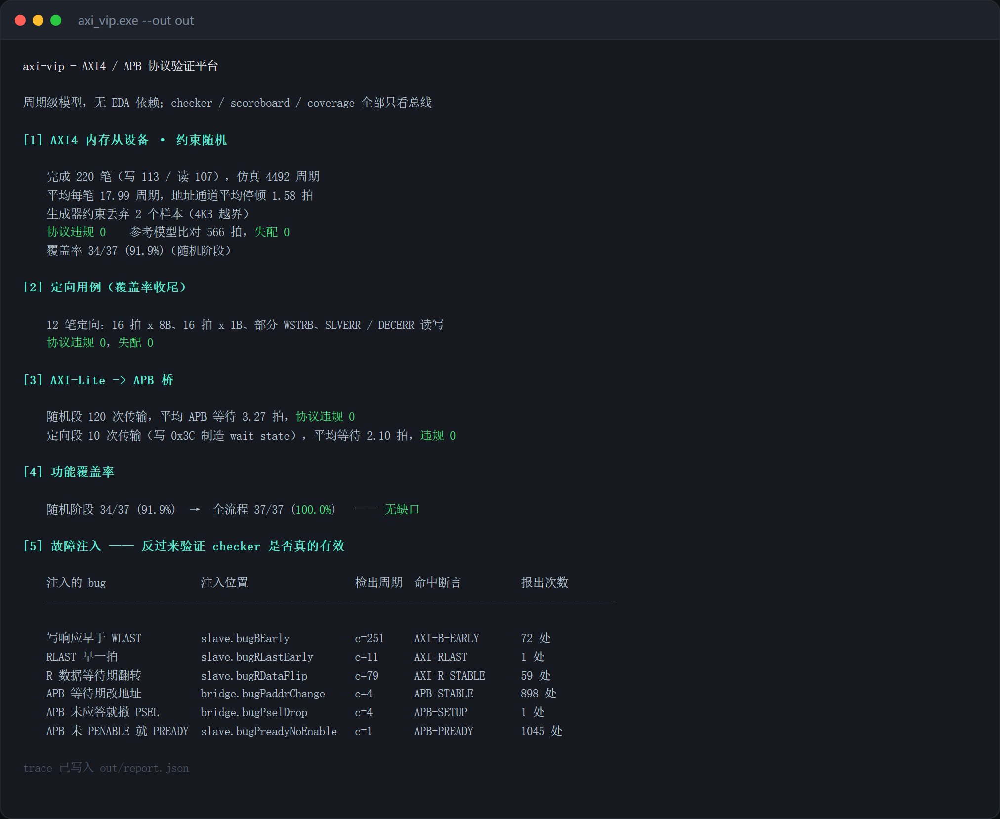
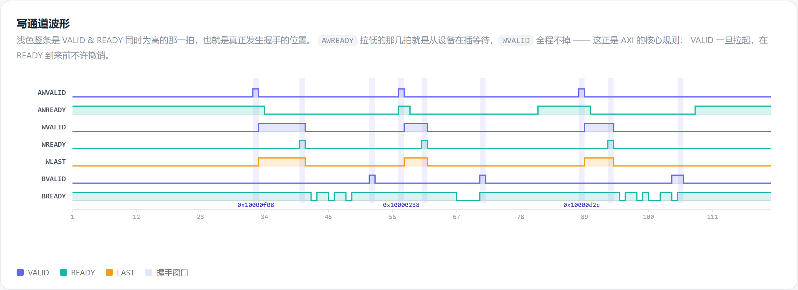
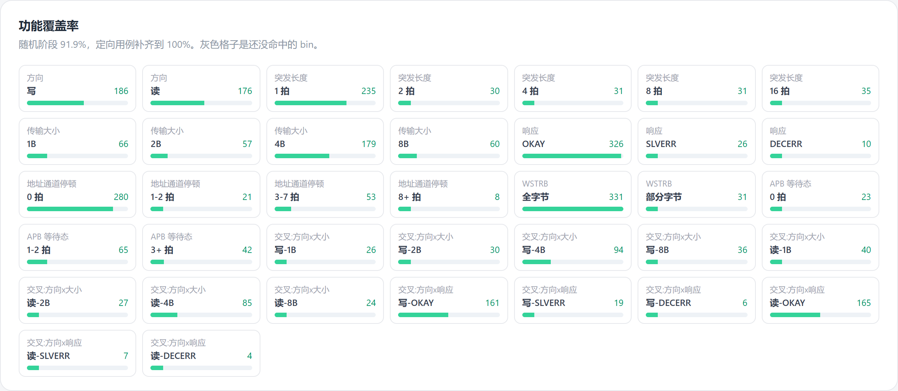

# axi-vip

一套**不依赖 EDA 工具**的 AMBA 协议验证平台：被测逻辑是 AXI4 从设备（带存储）和一个 AXI-Lite → APB 桥，
外面配完整的 VIP —— 约束随机驱动器、14 条协议断言、独立参考模型 scoreboard、37 个功能覆盖点，
外加 6 个可注入的时序 bug 用来反过来验证 checker 本身有效。

```
[1] AXI4 内存从设备 · 约束随机
    完成 220 笔（写 113 / 读 107），仿真 4492 周期
    协议违规 0    参考模型比对 566 拍，失配 0
    覆盖率 34/37 (91.9%)（随机阶段）
[4] 功能覆盖率
    随机阶段 34/37 (91.9%)  →  全流程 37/37 (100.0%)   —— 无缺口
[5] 故障注入
    写响应早于 WLAST     →  c=251   AXI-B-EARLY     72 处
    RLAST 早一拍         →  c=11    AXI-RLAST       1 处
    R 数据等待期翻转     →  c=79    AXI-R-STABLE    59 处
    APB 等待期改地址     →  c=4     APB-STABLE      898 处
    APB 未应答就撤 PSEL  →  c=4     APB-SETUP       1 处
    无 PENABLE 就 PREADY →  c=1     APB-PREADY      1045 处
```



---

## 为什么做这个

芯片验证岗的 JD 里几乎都会写「熟悉 AMBA AXI/APB 协议、能写 VIP 与断言、有覆盖率驱动验证经验」。
用真 UVM 环境复现一遍需要 Questa/VCS，而这些工具装不起来也不该出现在简历项目里。

所以这个项目换个办法：**把总线协议用 C++ 周期级模型实现一遍**，让每一根 valid/ready、每一次握手、
每一个响应都跑在用户代码里。这样断言、参考模型和覆盖率都能自己写，还能把 bug 注进去看断言抓不抓得到 ——
在没有 EDA 的前提下，把「验证方法学」这件事做完整。

## 被测对象

```
             AXI4 (AW/W/B + AR/R)
   AxiMaster ───────────────────► AxiMemSlave
   (VIP driver)                     ├─ [0x000,0xF00)  正常存储，OKAY
                                    ├─ [0xF00,0x1000) 故障寄存器，SLVERR
                                    └─ 其余            未映射，DECERR

             AXI-Lite                  APB (SETUP/ACCESS)
   AxiMaster ─────────► Axi2ApbBridge ─────────► ApbRegSlave
                        (DUT)                    16 个寄存器，0x3C 是"等待发生器"
```

| 文件 | 内容 |
| --- | --- |
| `src/sim.h` | 总线信号、事务、RNG、覆盖率容器 |
| `src/dv.h` | 各组件接口 |
| `src/master.cpp` | VIP driver：约束随机 + 定向脚本 |
| `src/slave.cpp` | AXI4 从设备（DUT），含 3 类可注入 bug |
| `src/apb.cpp` | AXI-Lite→APB 桥 + APB 寄存器从机（含 3 类 bug） |
| `src/check.cpp` | 14 条协议断言 + 参考模型 scoreboard + 覆盖率采样 |
| `src/main.cpp` | 回归编排、终端报告、trace 导出 |
| `tools/report.py` | report.json → 单文件 HTML（波形 / 覆盖率网格 / bug 表） |

## 时间模型：总线快照 + 两段式求值

这是整个项目最关键的一个设计，也是我踩得最狠的坑。

最直觉的写法是「每个周期依次调用各模块的 `eval(bus)`」。但这样有个隐蔽问题：**先 eval 的一方会把共享结构体
里属于它的信号改成下一拍的值，后 eval 的一方读到的就不是本拍的总线了。**

具体表现：主设备握手当拍就把 `wdata` 推到了下一拍，从设备于是把「下一拍的数据」写进了当前地址。
现象是 scoreboard 大面积失配（566 拍里 54 拍错），但协议断言一条都不报 —— 因为每根线单独看都合法。

最后的解法是把「读」和「写」彻底分开：

```cpp
const Axi bus = a;              // 本拍总线快照，谁也不许改
hs = f(bus);                    // 握手判定、checker、scoreboard 都只看快照
Axi nxt = a;
slv.eval(nxt, bus, hs);         // 只读 bus，只写 nxt
mst.eval(nxt, bus, hs);
a = nxt;                        // 统一提交，进入下一拍
```

APB 侧还要多一步：`PREADY` 本质是对**本拍** `PSEL/PENABLE` 的组合应答，所以从机必须读桥这一拍刚驱动的
信号（`reg.eval(pnext, pnext)`），否则等待拍数会整体偏移一拍，断言 `APB-PREADY` 会误报。

## 断言清单（14 条）

| 规则 | 内容 |
| --- | --- |
| `AXI-AW-STABLE` / `W` / `AR` / `R` / `B` | VALID 拉起后、READY 到来前不许撤销，载荷不许变 |
| `AXI-4KB` | INCR 突发不能跨 4KB 边界 |
| `AXI-WLAST` / `AXI-RLAST` | LAST 只能出现在第 `LEN+1` 拍 |
| `AXI-W-LEN` | W 拍数必须等于 `AWLEN+1` |
| `AXI-B-EARLY` | 写响应不能早于 WLAST |
| `APB-SETUP` | SETUP（PSEL=1、PENABLE=0）必须正好一拍，下一拍进 ACCESS |
| `APB-STABLE` | PSEL 期间 PADDR/PWRITE/PWDATA 必须全程不变（以 SETUP 拍为基准） |
| `APB-ACCESS` | ACCESS 完成后必须回 SETUP/IDLE，不能连着两拍 ACCESS |
| `APB-PREADY` | PREADY 只能在 PENABLE 拉高之后出现 |

`APB-STABLE` 这条值得单独说：第一版我只比较相邻两拍，结果注入「等待期改地址」的 bug **一条都没报** ——
因为注入的实现是把地址整体偏移 0x4 后保持住，相邻两拍当然一样。改成以 SETUP 拍为基准全程比对才抓到。

## 覆盖率：37 个 bin，随机 91.9% → 定向 100%

| 组 | bins |
| --- | --- |
| 方向 | 写 / 读 |
| 突发长度 | 1 / 2 / 4 / 8 / 16 拍 |
| 传输大小 | 1 / 2 / 4 / 8 字节 |
| 响应 | OKAY / SLVERR / DECERR |
| 地址通道停顿 | 0 / 1-2 / 3-7 / 8+ 拍 |
| WSTRB | 全字节 / 部分字节 |
| APB 等待态 | 0 / 1-2 / 3+ 拍 |
| 交叉 | 方向×大小（8）、方向×响应（6） |

随机阶段拿不到的三个 bin 靠定向用例补齐：16 拍 × 8B 的满突发、SLVERR/DECERR 区间的读写、
以及往 0x3C 写不同值制造出的 0 / 1-2 / 3+ 拍 APB 等待。

## 跑起来

```bash
g++ -O2 -std=c++17 -Wall -Wextra -o build/axi_vip.exe src/*.cpp
./build/axi_vip.exe --out out          # 终端报告 + out/report.json
python tools/report.py out docs/report.html
```

`--json` 只打印一行汇总，方便接 CI；`--verbose` 会多打首条违规/首次失配的细节。

固定随机种子，连跑三次输出完全一致（4492 周期 / 220 笔 / 0 违规 / 0 失配）。

## 可视化报告

[docs/report.html](docs/report.html) —— 单文件，双击打开：

- 写通道 / 读通道波形：VALID/READY/LAST + 握手窗口 + 地址数据标注
- APB 两段式时序：SETUP / ACCESS 等待拍分色
- 覆盖率网格：37 个 bin 的命中次数
- 故障注入表：每个 bug 的检出周期与命中断言





## 已知局限

- **只做 INCR 突发**，没有 WRAP / FIXED，也没有 outstanding 多笔与乱序返回；
- **单主单从**，没有 interconnect / 地址译码矩阵；
- **没有 exclusive access、没有 QoS / region、没有低功耗接口**；
- 从设备的存储是 `std::map`，不是真实 SRAM 模型，所以测不出时序违例；
- AXI-Lite→APB 桥的 PREADY 采样比真实组合路径晚一拍，因此统计的是「从设备插入的 wait state」而不是桥观测到的周期数。

## 相关

- 同系列：`fifo-dv`（同步 FIFO 的 mini DV 平台）、`mini-rtos`（单核抢占式调度）、`micro-infer`（端侧推理内核）、`a2a-agent-hub`（A2A 多智能体网关）
